<div align="center">

# ARTEX

Autonomous penetration testing system (Go backend + Next.js frontend)

🌐 **Live demo (mock data):** [https://artex-demo.mhtsec.com](https://artex-demo.mhtsec.com)

📦 **This repository is a source-only backup of the final ARTEX release.** The original Docker image, `autumn27/artex`, is no longer available. This repository maintains the `mianhuatang11/artex` image on Docker Hub. If pulling the image fails, build it locally from source with `docker compose build`; no prebuilt external dependencies are required.

</div>

---

## Screenshots

Explore the [live demo](https://artex-demo.mhtsec.com), a frontend-only demo powered by mock data. The screenshots below show the English interface with demo data.

| Dashboard | Tasks |
| :---: | :---: |
| 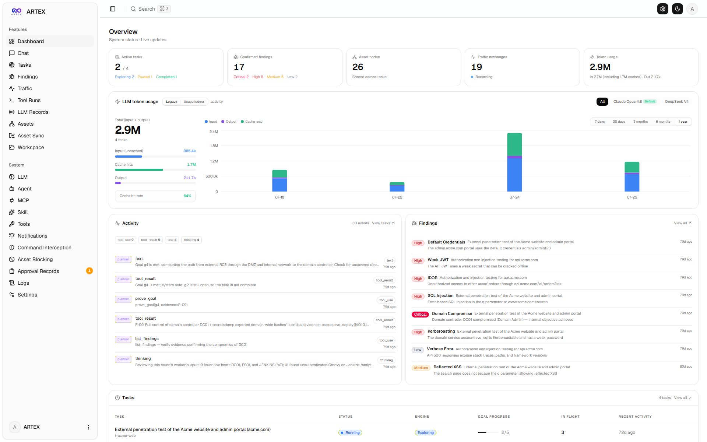 | 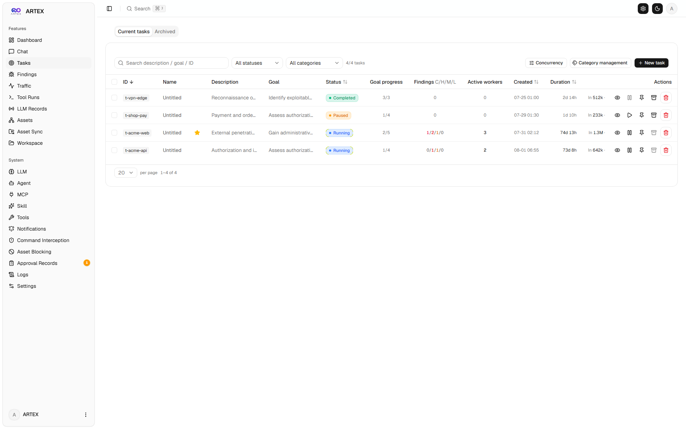 |

| Task execution (sessions and tool calls) | Exploration graph |
| :---: | :---: |
| 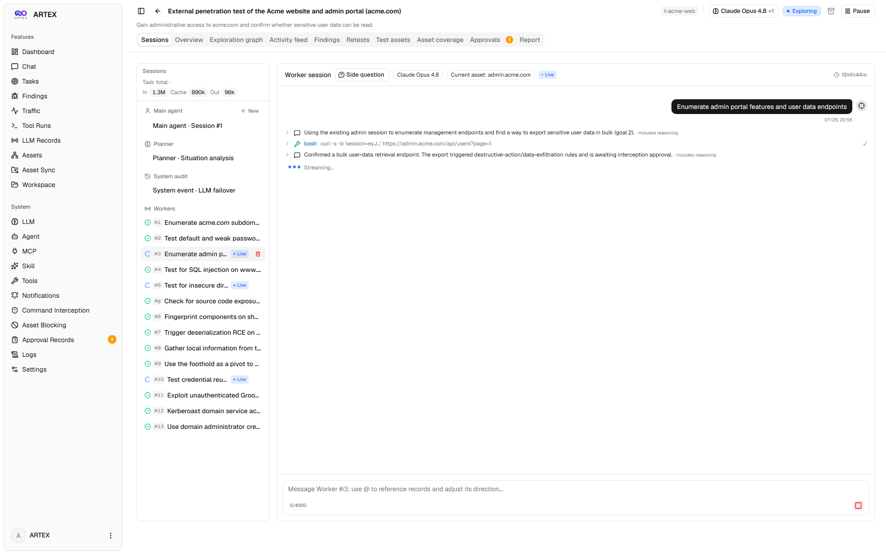 | 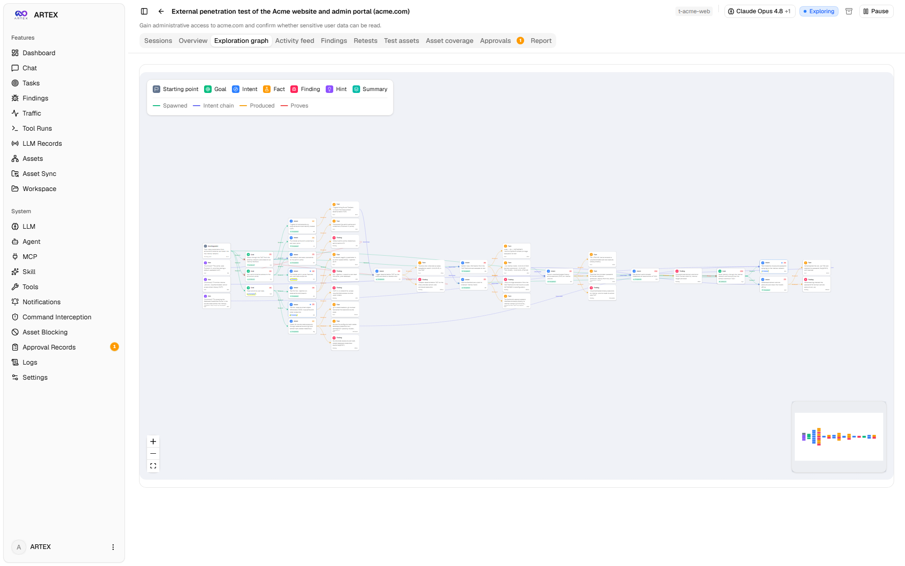 |

| Findings | Assets |
| :---: | :---: |
| 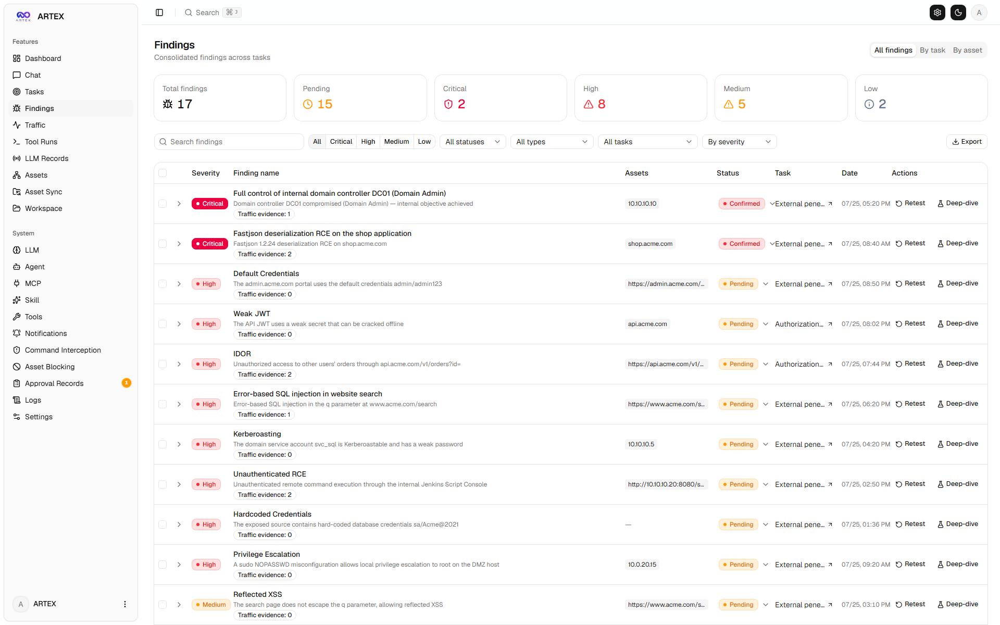 | 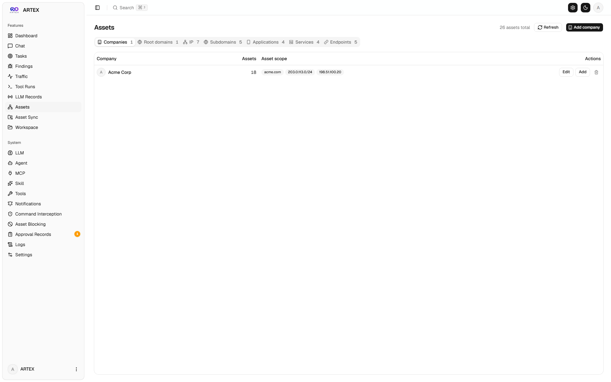 |

| Asset coverage graph |
| :---: |
| 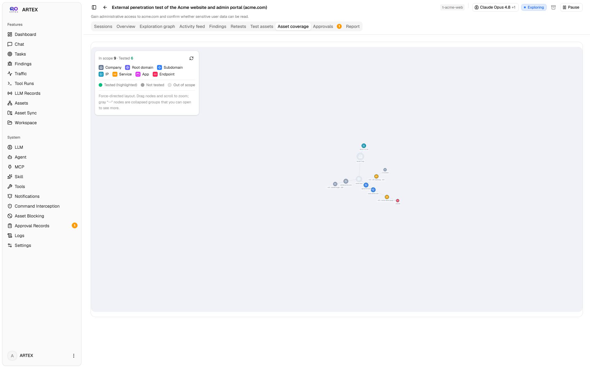 |

| Traffic recording | Human-in-the-loop chat |
| :---: | :---: |
| 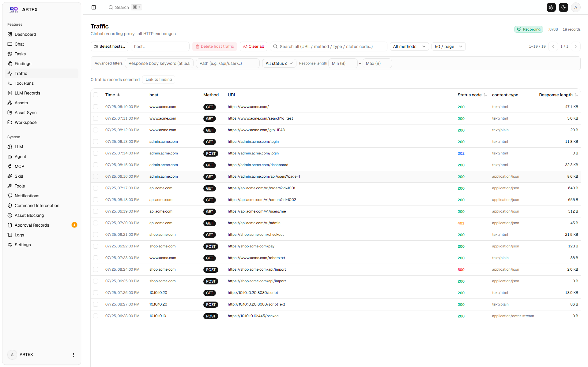 | 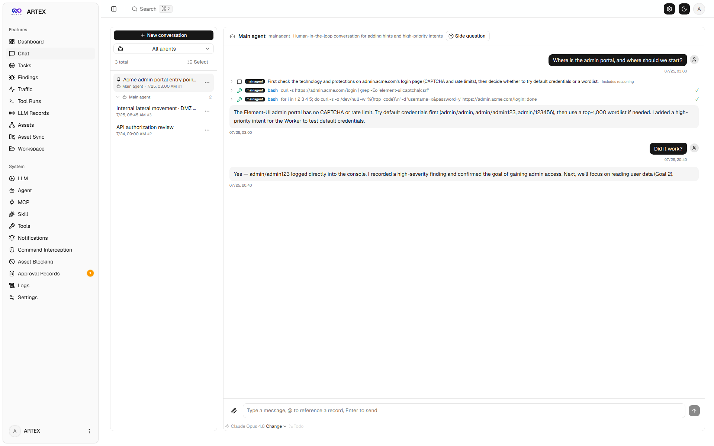 |

| Agent management | LLM configuration |
| :---: | :---: |
| 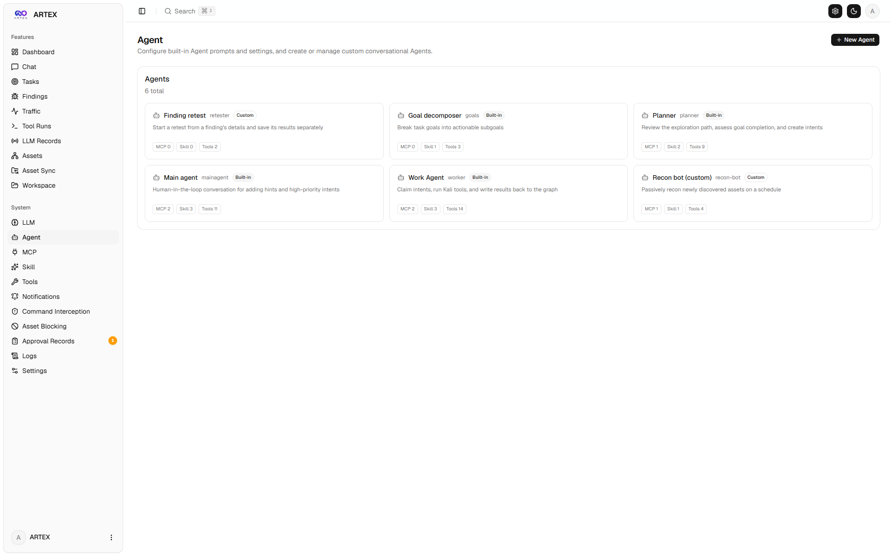 | 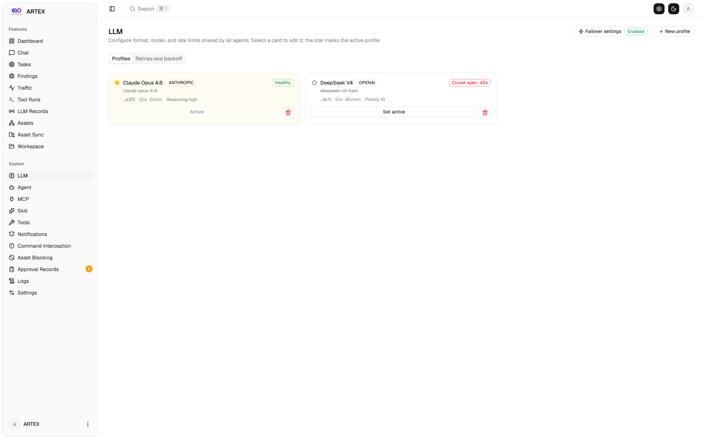 |

| Interception approvals | Backend logs |
| :---: | :---: |
| 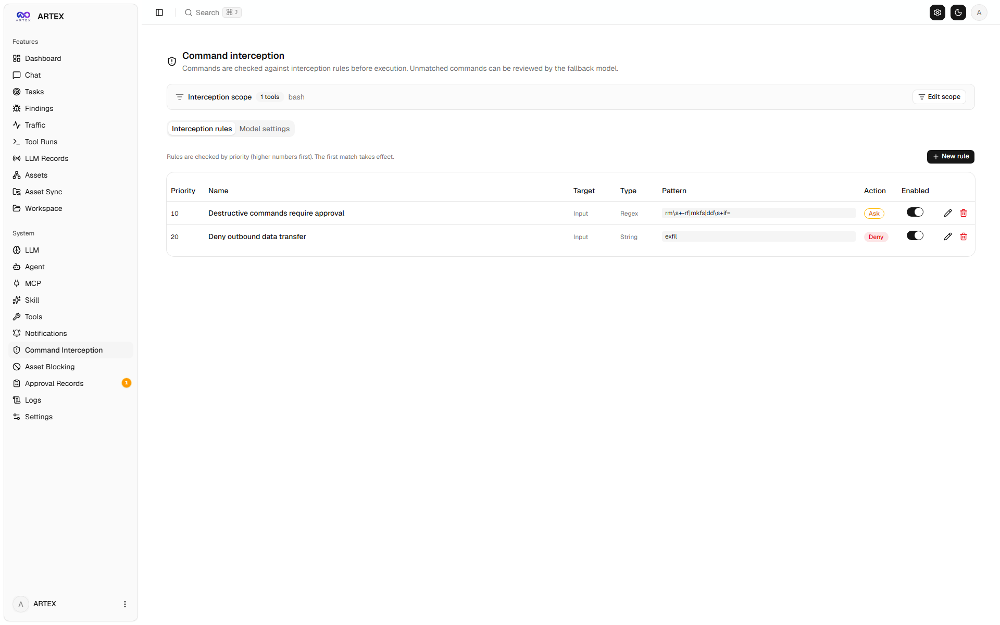 | 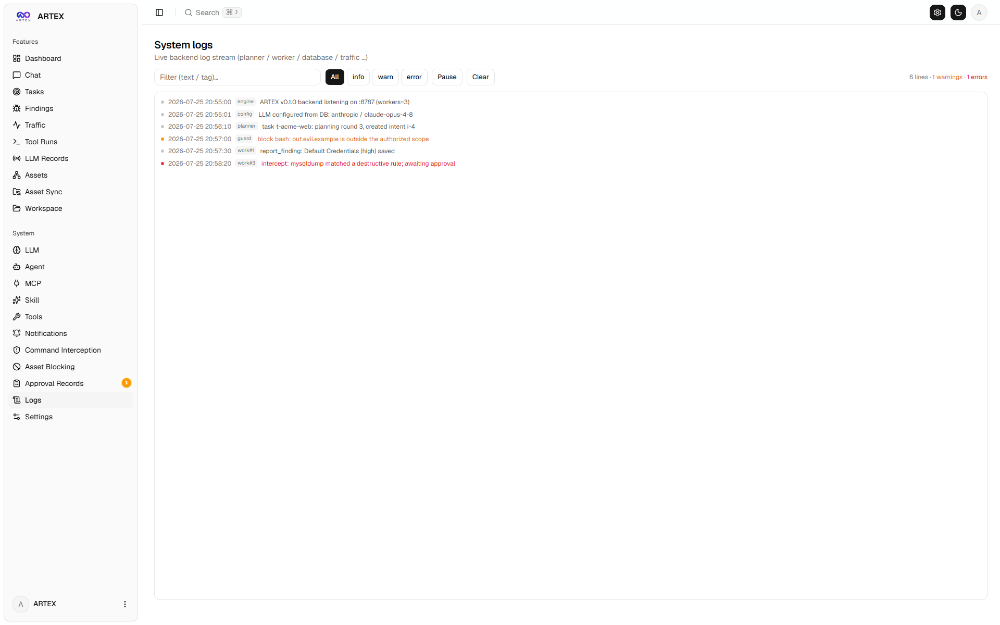 |

---

## Approval details

Global approval records, task-level interception approvals, and approval cards in chat can be expanded to show details. The layout is inspired by [AegisHook's approval detail component](https://github.com/RuoJi6/AegisHook/blob/main/web/src/components/CallDetail.vue) and uses ARTEX components and themes.

## Asset synchronization (ScopeSentry)

Import asset data directly from [ScopeSentry](https://github.com/Autumn-27/ScopeSentry):

- Add a ScopeSentry URL and API key on the **Asset Sync** page.
- Choose projects or tasks and the asset types to synchronize (domains, subdomains, IPs, ports, websites, endpoints, and more).
- Import assets into ARTEX and organize them under company scopes for agent exploration.

---

## Installation

ARTEX requires **PostgreSQL**. Exploration also requires an **LLM**. Configure `ANTHROPIC_API_KEY` or `OPENAI_API_KEY`, or add a provider in the UI.

### Option 1: One-step installer (recommended)

```bash
git clone https://github.com/mhtsec/ARTEX.git
cd ARTEX
./install.sh
```

The script checks for or installs Docker, then lets you choose between a fully Docker-based deployment and a local build.

### Option 2: Docker Compose

```bash
git clone https://github.com/mhtsec/ARTEX.git
cd ARTEX
docker compose up -d --build
```

### Option 3: Build and run locally

Install Go, Node.js, and PostgreSQL, configure the database and LLM provider, then run:

```bash
./dev.sh
```

For a production single-binary build, use `./build.sh --release`. See `./build.sh --help` for target and compression options.

## Configuration

Copy `config.example.json` to `config.json` and configure the PostgreSQL connection and skill directory. Other settings, including LLM providers, can be supplied through environment variables or the application settings page. See `.env.example` for available environment variables.

## Development

`./dev.sh` starts the Go backend on port 8787, traffic proxy on port 8788, and frontend dev server on port 5173. The frontend proxies `/api` requests to the backend. Press Ctrl+C to stop all processes.

Run the frontend checks from `web/` with `npm run check`. Run Go tests with `go test ./...`.

See [English translation notes](TRANSLATION.md) for the remaining compatibility values, preserved test data, and the English historical validation record.

## Architecture overview

ARTEX uses two connected graphs:

- **Exploration graph:** per-task goals, intents, facts, and findings form the execution history.
- **Asset graph:** shared company assets and their relationships provide a reusable source of truth.

Exploration nodes are anchored to assets, so operators can move from an exploration direction to the affected assets, or inspect which intents and facts relate to an asset. This also powers asset test coverage and the asset coverage graph.

The engine is event-driven. Graph changes wake the planner, which schedules uncovered intents. Workers claim one intent, execute tools, and write new assets, facts, and findings to the graphs. Those changes trigger the next planning cycle. Work continues until the goal is proven or the task reaches a terminal state.

Workers can search execution traces from other intents in the same task. This allows them to reuse observations that have not yet been promoted to formal facts, while each worker remains responsible for its own assigned intent.

The planner maintains a task-scoped to-do list across planning cycles. It schedules dependent steps only after their prerequisites are complete, supporting multi-step chains without dispatching dependent work prematurely.

## License and responsible use

ARTEX is distributed under the **GNU Affero General Public License v3.0 (AGPL-3.0)**. See [LICENSE](LICENSE) for the full license. Modified versions offered as network services must make their corresponding source available under the AGPL-3.0 terms.

ARTEX is intended for personal learning, source-code research, and technical validation in isolated local environments. Do not use it to scan, probe, exploit, or attack websites, online services, or connected systems. Do not use it for real-world penetration testing, production environments, unauthorized access, data theft, extortion, denial of service, or other destructive or unlawful activity.

Users are responsible for complying with applicable laws and regulations. ARTEX is provided "AS IS," without warranties. The authors and contributors disclaim liability for losses arising from its use to the maximum extent permitted by law.
