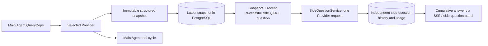

# ARTEX `/btw` Side Questions

Normal chat, a task's MainAgent, and each task's own Worker support independent side questions. Enter `/btw question` in the main input to submit a question. Enter `/btw` by itself or select **Bypass Question** to open the history. The history appears in a resizable desktop sidebar or a mobile drawer.

Each answer uses a snapshot of the Agent context captured when the question is submitted. Answers stream as they are generated, and can be stopped or cleared. Closing the panel, refreshing the page, or disconnecting SSE does not cancel a model request. Stopping affects only the current side question. Clearing cancels it and deletes the side-question history, while preserving the main context snapshot.

## Scope

The implementation uses Go, norma v0.3.7, Next.js, and the existing Markdown, ResizablePanel, Drawer, and AlertDialog components. It does not modify norma or add dependencies. Changes to the Planner, Workers inherited from other tasks, and tool-type subtasks are outside this scope.

- `capture.go` records main-loop requests only at `Options.Deps.CallModel` and `CallModelSync`. The Provider decorator sits inside the concrete model, after the routing pool selects a model, so the snapshot records the model actually used. Compression and digest requests do not replace the snapshot.
- A snapshot is published when a request starts, a complete model reply arrives, or a run reaches its final state. Partial replies are not published. Tool calls remain paired through norma's `MessagesForAPI`; tool results enter the snapshot at the next main-model request or at the end of the run. A streaming abort retains the last valid snapshot.
- Snapshots preserve structured messages, system prompts, tool definitions, and build parameters using JSON deep copies. Model inference does not hold snapshot locks or database transactions.
- `SideQuestionService` calls a specific Provider. It creates a side-question summary when needed and may retry once with a smaller context if the first request exceeds the context limit, provided no text or tool call has been emitted. It creates no Agent session and connects to no tool executor, main transcript, activity stream, or task graph. It does not use the task model-switching chain. Tool definitions are retained for compatibility with structured contexts, but summary requests receive no tools and returned tool calls are never executed.
- Only one request can run per parent session; a service process allows up to four concurrent requests. Each request has a 120-second timeout and its own cancellation context within the service lifecycle.
- Requests retain the model-configuration reference and a digest of non-sensitive identity fields. Credentials are loaded from the existing configuration when needed. If the configuration is deleted or its identity fields (such as model, protocol, or address) change, run the main Agent to refresh the snapshot before submitting another side question. Testing does not change the product's default model.

## Persistence and recovery

`db/schema.sql` creates `side_question_sessions` and `side_question_requests`. The session table stores the parent resource, latest snapshot, running request number, version, and cleared version. The request table stores questions, accumulated answers, status, model, snapshot time, usage, event sequence, and paging sequence.

The parent-session key uses a conversation ID, or a task ID plus exploration ID and intent ID. Workers do not use reusable execution-slot names.

Snapshots are merged per parent session and refreshed every 250 ms. Database comparisons on `(run_id, version)` prevent older snapshots from overwriting newer ones. The selected snapshot is saved again before a side question is admitted. After a successful save, its large in-memory copy is released; on failure, the pending version is retained. Streaming answer content is saved at most every 250 ms, and the final state is saved immediately with bounded retries if the database reports an error.

At service startup, any legacy request marked `running` becomes `interrupted`. Partial answers and usage are retained, and the request is not replayed automatically. The latest successfully saved context is available for the next question. Sessions without snapshots require running the main Agent first; context is not reconstructed from UI activity records.

Clearing increments the cleared version and deletes the request. Conditional updates prevent late callbacks from restoring cleared data. Deleting a parent resource relies on foreign-key cascading. Worker tombstones remove side-question data in the same transaction and reject later snapshots. Before archiving a task, the service blocks new requests, waits for the main process to stop, cancels side questions, and waits for them to finish. Archive format v3 supports v1 and v2 archives that lack the side-question table.

History is persisted in full and can be paged in groups of up to 20 items, ordered by sequence number. A model request can replay up to the 20 most recent successful question-and-answer pairs, subject to the token budget. Older pairs are represented by rolling summaries. If the main context exceeds the budget, only the older portion of the side-question copy is summarized; recent structured tool calls and results are retained. Summary and preparation work count toward concurrency, cancellation, timeout, and usage limits. See [Context Budgeting](CONTEXT_BUDGET.md) for details.

## HTTP contract

The following paths are used as `{parent}` and retain the existing authentication and resource checks:

- `/api/conversations/{id}`
- `/api/tasks/{id}/chat`
- `/api/tasks/{id}/intents/{iid}`

| Request | Response and behavior |
| --- | --- |
| `GET {parent}/side-questions?before={ordinal}` | Returns items newest first, independent `current` running status, snapshot metadata, and `next_cursor`. Cursor `0` requests the latest page or indicates there is no next page. |
| `POST {parent}/side-questions` | Accepts JSON `{ "question": "…", "client_request_id": "UUID" }`. A new request returns `202` and the request object. Repeating the same ID and question returns the existing object with `200`. |
| `DELETE {parent}/side-questions` | Cancels and clears side-question history for the current parent session. |
| `GET /api/side-questions/{requestID}/events` | Streams SSE events. `snapshot` carries the complete cumulative request object; `id` is the incremental sequence number. A `cleared` event is sent when history is cleared. |
| `POST /api/side-questions/{requestID}/cancel` | Cancels a request explicitly. Its final state remains available through history or SSE. |

Questions are limited to 4,000 characters. A missing snapshot, changed model configuration, busy parent session, or idempotency-key conflict returns `409`; exceeding the global concurrency limit returns `429`. Each SSE connection first receives the cumulative state, so it does not depend on earlier text fragments. The frontend merges events by request ID and sequence number, and ignores stale callbacks after switching parent sessions or clearing history.

## Verification and references

See [VALIDATION.md](VALIDATION.md) for automated checks, actual model usage, and known limitations.

The standalone-request design refers to [Grok CLI's side-question implementation](https://github.com/superagent-ai/grok-cli/blob/fb97af83f06dca873281d60168430f06c8de6324/src/utils/side-question.ts); request isolation refers to [OpenCode](https://github.com/anomalyco/opencode/tree/b3f1a96c6dd7adeb28b36dd11add1998fc84d67b). ARTEX uses norma's structured messages rather than assembling context from frontend logs.
