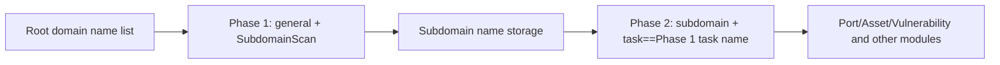

# ScopeSentry MCP User Guide

This guide is for users with a deployed ScopeSentry instance. Connect through Cursor or another MCP client; local source code is not required.

## 1. Preparation

### 1.1 Confirm that the service is accessible

- Default web interface: `http://<Host>`
- MCP endpoint: `http://<Host>/mcp` (use the externally accessible `/mcp` URL if the service is behind a proxy)

### 1.2 Create an API key

1. Log in to the ScopeSentry Web interface through a browser
2. Enter the **API Key** management page to create a key (or create it through the interface provided by the administrator)
3. Save the returned `ssk_...` string (**only displayed once**)

### 1.3 Configure MCP in Cursor

Cursor → Settings → MCP → Add Server:

```json
{
  "mcpServers": {
    "scopesentry": {
      "url": "http://<host>:8082/mcp",
      "headers": {
        "X-API-Key": "ssk_your_api_key"
      }
    }
  }
}
```

Also available: `Authorization: Bearer ssk_your_api_key`

After saving the configuration, reconnect the MCP server or reload Cursor. Confirm that tools such as `list_projects` and `list_assets` appear.

---

## 2. Tool List


| Tools | Purpose |
| ----------------------- | ------------------ |
| `list_projects` | Project tree grouped by tags (with project ID) |
| `list_projects_data` | Paginated list of projects, searchable by name |
| `get_project` | Project details |
| `create_project` | New project |
| `list_tasks` | Scanning task list |
| `get_task` | Scan task details |
| `list_scan_templates` | Scan template list |
| `get_scan_template` | Template details |
| `list_plugin_modules` | Scan pipeline module names |
| `list_plugins` | Available plug-ins (including hash, default parameters) |
| `create_scan_template` | Create scan template |
| `create_scan_task` | Create scan task |
| `list_assets` | Query various assets (paged list) |
| `count_assets` | Asset count (`/api/assets/common/total`) |
| `get_asset_detail` | Asset or vulnerability details |
| `add_asset_tag` | Add tags to assets |
| `list_nodes` | Scan node list |


Use each tool's schema to determine its supported parameters. `list_assets` and `count_assets` share the same search and filter syntax. Read the `list_assets` description before constructing queries.

Use `count_assets` for totals rather than fetching every page with `list_assets`. It corresponds to the total-count endpoint used by the web interface.

---

## 3. Common workflow

### 3.1 Check assets by project

When a project is specified, include `filter.project` to narrow the query and reduce cross-project data. Omit this filter when no project is specified.

1. `list_projects` or `list_projects_data` gets the **ObjectID** of the target project (`id` / `children[].value`)
2. `list_assets` passes in `filter.project` (**use the project ID, not its display name**)

```json
{
  "asset_type": "asset",
  "pageIndex": 1,
  "pageSize": 20,
  "search": "domain=^example.com",
  "filter": {
    "project": [
      "<projectObjectID>"
    ]
  }
}
```

### 3.2 Create a scan task

1. Use `list_nodes` to find an online node name.
2. `list_scan_templates` or `create_scan_template` to get the template **ObjectID**
3. Call `create_scan_task` with the required `name` and `node` fields. Set `template` to the template ID.

**Target source `targetSource` (consistent with the web side):**

| targetSource | Description | Required parameters |
| --- | --- | --- |
| `general` | Directly enter the target | `target` |
| `project` | Read target from project | `project` (array of project ObjectIDs) |
| `asset` | Search the web asset inventory | `search`; Optional `project`, `filter`, `targetNumber` |
| `RootDomain` | Search from the root domain name database | `search`; optional `project`, `filter`, `targetNumber` |
| `subdomain` | Search from subdomain database | `search`; optional `project`, `filter`, `targetNumber` |
| `UrlScan` | Search from URL scan results | `search`; optional `project`, `filter`, `targetNumber` |
| `*Source` (such as `subdomainSource`) | Created from "Select/Search" on the asset page | Use `search` for `targetTp=search`; use `targetIds` for `targetTp=select` |

**Example—Scan the root domain name directly:**

```json
{
  "name": "example-subdomain-discovery",
  "node": [
    "node-1"
  ],
  "template": "<templateObjectID>",
  "targetSource": "general",
  "target": "example.com\nfoo.com",
  "project": [
    "<projectObjectID>"
  ]
}
```

**Example - Continue scanning from the subdomain name database (filter by previous task name):**

```json
{
  "name": "example-port-and-vulnerability-scan",
  "node": [
    "node-1"
  ],
  "template": "<Subsequent module template ObjectID>",
  "targetSource": "subdomain",
  "search": "task==\"example-subdomain-discovery\"",
  "project": [
    "<projectObjectID>"
  ]
}
```

### 3.3 Discover root-domain assets in two stages

For comprehensive discovery starting from **root domains**, split scanning into two stages.

Tasks are distributed by **individual target**. If one node receives a root domain, it also runs subsequent modules for all subdomains it discovers. Large domains can therefore overload a single node. A separate second stage distributes discovered subdomains across the available nodes.

**Best Practices:**

1. **Phase 1 – Subdomain Collection Only**
   - `targetSource`: `general`
   - `target`: All root domain names (multiple lines)
   - Template: Only enable `SubdomainScan`, `SubdomainSecurity` (subdomain scanning + subdomain takeover)
   - Use `get_task` to wait for the task to complete

2. **Phase 2 – Subsequent Modules**
   - `targetSource`: `subdomain`
   - `search`: `task=="<First stage task name>"` (exact task-name match).
   - Optionally include `project` to narrow the scope.
   - Template: port scanning, asset mapping, vulnerability scanning, and similar modules; omit `SubdomainScan`.
   - Each subdomain is an independent target, allowing the nodes to share the work.

You can also use "Create task from subdomain name" after filtering by task name on the "Subdomain name" asset page of the web interface, with the same effect.



### 3.4 Create a scan template

1. `list_plugin_modules` → module name list
2. `list_plugins` (can be filtered by `module`) → each plug-in `hash` and the default `parameter`
3. `create_scan_template`: Use `modules` to specify "module → plug-in hash array"

---

## 4. Asset query (`list_assets` / `count_assets`)

`count_assets` accepts the same `asset_type`, `search`, and `filter` values as `list_assets`. It returns `{ "total": N }`, matching the web interface's `/api/assets/common/total` endpoint.

```json
{
  "asset_type": "subdomain",
  "search": "task==\"a task name\"",
  "filter": {
    "project": [
      "<projectObjectID>"
    ]
  }
}
```

**Query performance:** For both tools, narrow queries with `filter.project` when a project is specified. On indexed fields, prefer exact matching with `==` or anchored prefix matching with `^` (see [4.3](#43-search-expressions)). Broad regex searches using `=` can be slow on large datasets.

The types that support `filter.project` are shown in the [4.4](#44-exact-filters) table.

### 4.1 Asset type `asset_type`

`asset`, `RootDomain`, `subdomain`, `app`, `mp`, `UrlScan`, `SensitiveResult`, `DirScanResult`, `crawler`, `vulnerability`, `PageMonitoring`, `IPAsset`, `SubdomainTakerResult`

Examples of aliases: `web`→asset, `vuln`→vulnerability, `ip`→IPAsset, `url`→UrlScan

### 4.2 Parameter description


| Parameters | Description |
|------------------------|---------------------------------------------|
| `pageIndex` / `pageSize` | Paging, default 1 / 20 |
| `search` | Search expression (see next section) |
| `filter` | Precisely filter JSON (see next section) |
| `sort` | Only UrlScan and DirScanResult support sorting by `length` |
| `sid` | SensitiveResult only: Sensitive rule name |


`search` and `filter` **can be used simultaneously**.

### 4.3 Search expressions

Custom DSL (**not SQL**):


| Operator | Meaning | Index | Example |
| ---- | ---- | ---- | ---------------------------- |
| `=` | Fuzzy matching (regex) | No indexing | `domain=example` |
| `==` | Exact match | **Uses an index** | `port==443` |
| `!=` | Exclusion | — | `port!="80"` |
| `&&` | and | — | `domain==example.com && port==443` |
| `||` | or | — | `title=admin || body=login` |


**Indexes and operators:** Indexed fields include `domain`, `ip`, `port`, and `title`. Exact matches with `==` and anchored prefix searches such as `domain=^example.com` can use indexes. General regex searches with `=` cannot use those indexes and may be slow on large datasets.

**Search field common to all types:** `tag`, `task` (task name), `rootDomain`

**project cannot be written in search** (invalid or an error will be reported when combined with `&&`). Use `filter.project` to filter by project.

**Commonly used search fields of various types:**


| asset_type | field |
| -------------------- | --------------------------------------------------------------------------------------------------- |
| asset | domain, ip, port, service, app, title, statuscode, icon, banner, type, body, header |
| RootDomain | domain, icp, company |
| subdomain | domain, ip, type, value |
| app | name, icp, company, category, description, url, apk |
| mp | name, icp, company, category, description, url |
| UrlScan | url, input, source, resultId, type |
| SensitiveResult | url, sname, body, info, md5 |
| DirScanResult | url, statuscode, redirect, length |
| vulnerability | url, vulname, matched, request, response, level |
| crawler | url, method, body, resultId |
| PageMonitoring | url, hash, diff, response |
| IPAsset | ip, domain, port, service, webServer, app |
| SubdomainTakerResult | domain, value, type, response |


**search example:**

- `domain==www.example.com && port==443` (exact match, indexed)
- `domain=^example.com` (prefix matching, indexing)
- `ip==192.168.1.1`
- `task=="A task name"`
- `level==high` (vulnerability)
- `statuscode==200` (DirScanResult)

Use `=` for broader matches such as `title=admin`. Narrow the query with project or other filters to limit the cost of an unindexed search.

### 4.4 Exact filters

In the JSON filter object, multiple values for one key are combined with **OR**; different keys are combined with **AND**.

Include **`filter.project`** when a project is specified and the asset type supports it. Otherwise, leave the project filter unset.


| filter key | meaning | value description |
| ------------ | -------- | -------------------------------------------------------- |
| `project` | Project | **ObjectID**, obtained with `list_projects` / `list_projects_data` |
| `task` | Source Task | **task name**, `name` using `list_tasks` |
| `port` | port | such as `"443"` |
| `service` | Service/Protocol | Such as `"https"` |
| `app` | Application fingerprint | Such as `"Nginx"` |
| `icon` | Icon hash | |
| `statuscode` | HTTP status code | Mainly used for asset |
| `status` | Status | UrlScan/DirScan HTTP code; vulnerability/sensitive information processing status |
| `level` | Vulnerability level | critical / high / medium / low / info |
| `type` | Type | Such as subdomain name record type A, CNAME |
| `color` | Sensitive rule color | SensitiveResult |
| `sname` | Sensitive rule name | SensitiveResult |
| `tags` | Tags | |


**Filter key available for each type:**


| asset_type                            | filter key                                                      |
| ------------------------------------- | --------------------------------------------------------------- |
| asset                                 | project, port, service, app, icon, statuscode, type, task, tags |
| RootDomain                            | project, tags                                                   |
| subdomain                             | project, type, task, tags                                       |
| app / mp                              | project, tags                                                   |
| UrlScan                               | status, tags                                                    |
| DirScanResult                         | status, tags                                                    |
| SensitiveResult                       | status, color, sname, tags                                      |
| crawler                               | project, task, tags                                             |
| vulnerability                         | project, level, status, task, tags                              |
| PageMonitoring / SubdomainTakerResult | tags                                                            |
| IPAsset                               | project, port, service, app                                     |


**filter example:**

```json
{
  "project": [
    "<projectObjectID>"
  ],
  "port": [
    "443"
  ]
}
```

**Combined query example:**

```json
{
  "asset_type": "asset",
  "search": "domain=^baidu && port==443",
  "filter": {
    "project": [
      "<projectObjectID>"
    ]
  },
  "pageIndex": 1,
  "pageSize": 10
}
```

**Notice:**

- `filter.project` is preferred when there are project conditions (when supported); it is not mandatory if there is no project context.
- Use project ObjectIDs in `filter.project`.
- Use `==` for known values and `^` for prefixes; limit broad regex searches on large tables.
- UrlScan's HTTP status uses `filter.status`; DirScanResult can use `statuscode==200` in search
- For SensitiveResult rule names, use `sname=<rule name>` in `search` or set `filter.sname`.

### 4.5 Sorting

Only **UrlScan**, **DirScanResult** support:

```json
{
  "length": "ascending"
}
```

Other types ignore `sort` and sort by time by default.

---

## 5. Scan template module names

`TargetHandler`, `SubdomainScan`, `SubdomainSecurity`, `PortScanPreparation`, `PortScan`, `PortFingerprint`, `AssetMapping`, `AssetHandle`, `URLScan`, `WebCrawler`, `URLSecurity`, `DirScan`, `VulnerabilityScan`, `PassiveScan`

---

## 6. Troubleshooting


| Problem | Resolution |
| --------- | -------------------------------------------------- |
| No MCP tools available | Check the URL, API key, and service availability |
| 401 / 403 | Recreate or replace API Key |
| Asset cannot be found | Confirm `filter.project` is ObjectID; do not write project in search |
| Template/task creation failed | `template` must be the template ObjectID; `node` fills in the online node name |
| Query is very slow/stuck | Use `filter.project` when a project is specified, prefer exact or prefix searches on indexed fields, and reduce `pageSize` |


---

